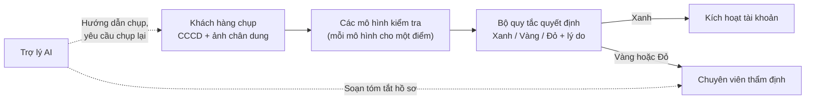
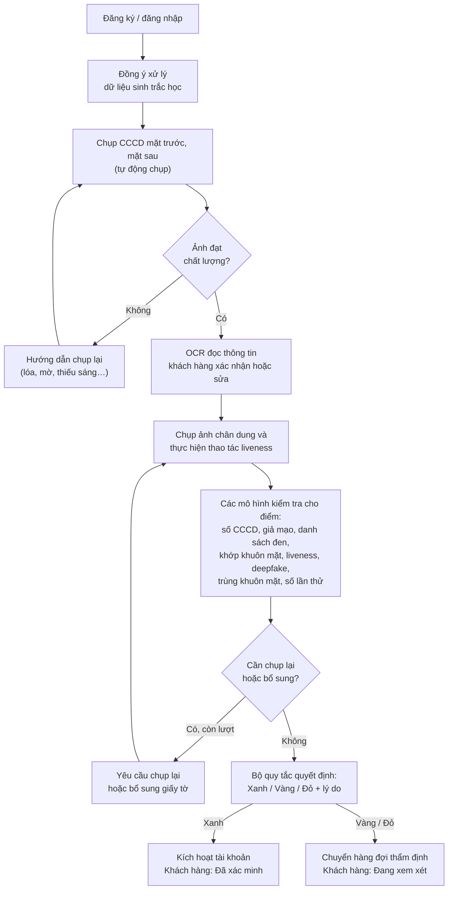
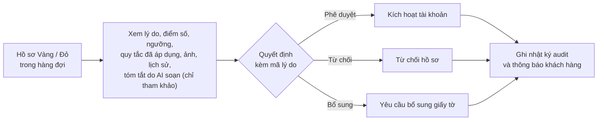
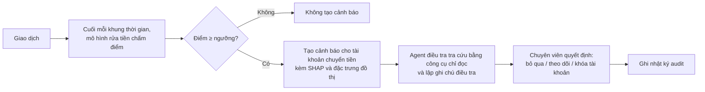

# Tài liệu yêu cầu sản phẩm (PRD): Agentic KYC/AML

## 1. Thông tin chung
| Mục | Nội dung |
|---|---|
| Tên sản phẩm | Agentic KYC/AML |
| Đề tài | AI Agent KYC/eKYC & Xác minh danh tính tự động |
| Nhóm | T163 |
| Track | Fintech |
| Phiên bản | v1 (bản nháp) |
| Ngày cập nhật | 13/11/2026 |

Tài liệu này mô tả yêu cầu sản phẩm dựa trên đề bài của môn học. Khi có khác biệt giữa tài liệu này và đề bài, đề bài được ưu tiên.

## 2. Tổng quan sản phẩm
Agentic KYC/AML là ứng dụng web hỗ trợ ví điện tử và công ty fintech trong hai nghiệp vụ:

1. **Định danh khách hàng điện tử (eKYC)** khi mở tài khoản. Khách hàng chụp CCCD và ảnh chân dung bằng camera. Hệ thống kiểm tra giấy tờ, khuôn mặt, dấu hiệu giả mạo và danh sách đen, sau đó phân loại hồ sơ thành Xanh, Vàng hoặc Đỏ kèm lý do.
2. **Giám sát giao dịch** sau khi mở tài khoản, trong đó phòng, chống rửa tiền (AML) là ưu tiên. Hệ thống chấm điểm giao dịch, tạo cảnh báo khi có dấu hiệu rửa tiền và lập ghi chú điều tra để chuyên viên thẩm định xem xét.

Trong hệ thống, mô hình ngôn ngữ lớn (LLM) chỉ đảm nhận việc điều phối các bước, hướng dẫn khách hàng và soạn phần giải thích. Mọi con số do thuật toán xác định (deterministic) tính toán. Mọi quyết định do bộ quy tắc quyết định hoặc chuyên viên thẩm định đưa ra.

## 3. Bối cảnh và vấn đề
**Định danh khách hàng.** Mở ví hoặc tài khoản fintech cần eKYC: đối chiếu CCCD với ảnh chân dung của khách hàng. Quy trình thủ công chậm, dễ sai sót và dễ bị lợi dụng bằng giấy tờ giả, ảnh in, video quay sẵn hoặc deepfake.

**Giám sát giao dịch.** Dữ liệu giao dịch có khối lượng lớn và nhãn mất cân bằng nghiêm trọng: tỷ lệ giao dịch gian lận hoặc rửa tiền chỉ khoảng 0,1% ở PaySim và IBM AML, vài phần trăm ở IEEE-CIS. Hành vi gian lận cũng thay đổi liên tục. Gian lận thường thể hiện ở một giao dịch bất thường. Rửa tiền thì thể hiện qua chuỗi giao dịch giữa nhiều tài khoản, ví dụ dồn tiền về một tài khoản trung gian (fan-in), phân tán tiền ra nhiều tài khoản (fan-out) hoặc chuyển tiền theo vòng.

**Yêu cầu từ đề bài.** Tính toán số học phải chính xác tuyệt đối, kết luận rủi ro phải có giải thích định lượng, và con người phải phê duyệt trước khi kích hoạt hồ sơ rủi ro hoặc khóa tài khoản.

**Vai trò của AI.** Quy trình eKYC gồm nhiều bước, và bước tiếp theo phụ thuộc vào kết quả bước trước (ảnh mờ, thiếu mặt sau CCCD, điểm khớp khuôn mặt sát ngưỡng). AI phù hợp với việc điều phối, hướng dẫn khách hàng và giải thích kết quả. AI không được dùng để tính toán hay ra quyết định, theo đúng ràng buộc của đề bài.

## 4. Mục tiêu
| # | Mục tiêu | Chỉ số đo |
|---|---|---|
| G1 | Khách hàng hợp lệ tự hoàn tất eKYC trên điện thoại. Các hình thức gian lận phát hiện được bằng quy tắc (danh sách đen, trùng khuôn mặt, sai cấu trúc số CCCD…) không bao giờ được xếp Xanh. Giấy tờ giả và khuôn mặt giả bị phát hiện với tỷ lệ mục tiêu từ 95% | Tỷ lệ từ chối nhầm khách hàng hợp lệ; tỷ lệ phát hiện theo từng loại gian lận |
| G2 | Cảnh báo rửa tiền có ích cho chuyên viên: số cảnh báo sai được giới hạn, phát hiện được nhiều trường hợp rửa tiền nhất trong giới hạn đó, mỗi cảnh báo có giải thích định lượng | Recall và precision tại ngưỡng vận hành; recall theo từng mẫu rửa tiền; giá trị SHAP trên mỗi cảnh báo |
| G3 | LLM không thể ra quyết định, tự tính toán hay làm lộ dữ liệu cá nhân; khi tắt LLM, kết quả không thay đổi | Bộ kiểm thử an toàn: 0 vi phạm |
| G4 | Mọi quyết định đều truy vết và tái hiện được | Tái hiện quyết định từ nhật ký audit: 100% |

## 5. Đối tượng sử dụng
| Vai trò | Nhu cầu | Chức năng chính |
|---|---|---|
| Khách hàng | Mở tài khoản bằng điện thoại hoặc máy tính | Chụp CCCD và ảnh chân dung có hướng dẫn; nhận hướng dẫn chụp lại; xem kết quả "Đã xác minh" hoặc "Đang xem xét" |
| Chuyên viên thẩm định | Xử lý hồ sơ Vàng, Đỏ và cảnh báo rửa tiền | Hàng đợi hồ sơ; lý do, điểm số, cảnh báo độ tin cậy; chi tiết quy tắc đã áp dụng hoặc SHAP; phần tóm tắt do AI soạn; lịch sử audit |
| Quản trị viên | Vận hành hệ thống | Cấu hình ngưỡng, cập nhật danh sách đen, chạy đánh giá, theo dõi độ lệch dữ liệu |

## 6. Giải pháp tổng quan

### 6.1 Quy trình ra quyết định eKYC

| Thành phần | Chức năng | Ví dụ |
|---|---|---|
| Mô hình kiểm tra | Mỗi mô hình đánh giá một tiêu chí và trả về điểm | Điểm khớp khuôn mặt 0,41; điểm giả mạo giấy tờ 0,92 |
| Bộ quy tắc quyết định | Chuyển các điểm thành kết quả Xanh, Vàng hoặc Đỏ kèm lý do. Đây là thuật toán thuần, cùng một bộ điểm luôn cho cùng một kết quả | Điểm giả mạo vượt ngưỡng → Đỏ, lý do "Giấy tờ giả mạo" |
| Trợ lý AI | Hướng dẫn khách hàng, yêu cầu chụp lại khi ảnh không đạt, soạn tóm tắt cho chuyên viên. Không tham gia ra quyết định | "Vui lòng chụp lại mặt sau CCCD do ảnh bị lóa" |
| Chuyên viên thẩm định | Quyết định cuối cùng với mọi hồ sơ Vàng và Đỏ | Phê duyệt, từ chối hoặc yêu cầu bổ sung giấy tờ |

| Kết quả | Ý nghĩa | Xử lý |
|---|---|---|
| Xanh | Tất cả kiểm tra đều đạt | Tự động kích hoạt tài khoản |
| Vàng | Hệ thống chưa đủ cơ sở kết luận (ví dụ điểm khớp khuôn mặt sát ngưỡng, nghi ngờ deepfake) | Chuyển chuyên viên xem xét |
| Đỏ | Có dấu hiệu gian lận rõ ràng (ví dụ có trong danh sách đen, CCCD giả, một khuôn mặt đăng ký với nhiều số CCCD) | Chuyển chuyên viên xác nhận và xử lý |

Lý do đi kèm hồ sơ Vàng hoặc Đỏ gồm: có trong danh sách đen, trùng danh tính, giấy tờ giả mạo, sai cấu trúc số CCCD, khuôn mặt không khớp, nghi ngờ giả mạo khuôn mặt, nghi ngờ deepfake, số lần thử bất thường, hết lượt chụp lại, OCR không đủ tin cậy, lỗi kiểm tra, thiếu kiểm tra.

Khách hàng chỉ thấy "Đã xác minh" hoặc "Đang xem xét", không thấy điểm số hay lý do. Điều này tránh việc đối tượng gian lận dò ra tiêu chí kiểm tra.

### 6.2 Phân tách trách nhiệm
Đề bài yêu cầu tách biệt hoàn toàn tầng tính toán khỏi tầng suy luận của LLM.

| Tầng | Được phép | Không được phép |
|---|---|---|
| LLM (điều phối, giải thích, điều tra) | Chọn bước tiếp theo, đặt câu hỏi cho khách hàng, soạn văn bản dựa trên kết quả của công cụ | Tính toán hoặc thay đổi số liệu; khẳng định khớp danh tính; phê duyệt, từ chối hoặc khóa tài khoản |
| Tầng tính toán xác định (mô hình kiểm tra, bộ quy tắc, đồ thị giao dịch, tính tiền) | Tạo ra mọi điểm số, số tiền, đặc trưng và kết quả Xanh/Vàng/Đỏ, kèm chi tiết quy tắc hoặc SHAP | — |
| Chuyên viên thẩm định | Quyết định cuối cùng với hồ sơ Vàng, Đỏ và mọi thao tác trên giao dịch | — |

## 7. Phạm vi
Sản phẩm gồm hai nhóm chức năng, dùng chung hàng đợi thẩm định, nhật ký audit và bộ đánh giá.

### 7.1 Định danh khách hàng (eKYC)
| Chức năng | Mô tả |
|---|---|
| Ứng dụng web, đăng nhập, phân quyền | Triển khai trên cloud; ba vai trò: khách hàng, chuyên viên thẩm định, quản trị viên |
| Chụp giấy tờ bằng camera | Chụp CCCD mặt trước và mặt sau, tự chọn khung hình rõ nhất; hướng dẫn trực tiếp khi ảnh quá tối, lóa, mờ, ở xa hoặc bị rung |
| Kiểm tra chất lượng ảnh | Phát hiện ảnh mờ, lóa, bị cắt hoặc không có thẻ; yêu cầu chụp lại kèm hướng dẫn cụ thể |
| Nhận dạng ký tự (OCR) | Đọc các trường trên CCCD; khách hàng xác nhận hoặc chỉnh sửa; bản chỉnh sửa được lưu riêng, không ghi đè kết quả OCR và được hiển thị cho chuyên viên |
| Kiểm tra số CCCD | Kiểm tra cấu trúc 12 chữ số (mã tỉnh, thế kỷ và giới tính, năm sinh) và sự khớp với ngày sinh, giới tính; ngày tháng hợp lệ; thẻ còn hạn |
| Phát hiện giấy tờ giả | Mô hình phát hiện giả mạo và chụp lại từ màn hình, kết hợp với lỗi cấu trúc CCCD thành điểm rủi ro giả mạo |
| Kiểm tra người thật (liveness) | Máy chủ chọn ngẫu nhiên một thao tác (ví dụ quay đầu sang trái rồi chớp mắt); khách hàng thực hiện trong một đoạn video ngắn; máy chủ phân tích video |
| Đối chiếu khuôn mặt | So khớp ảnh chân dung trên CCCD với ảnh chụp trực tiếp |
| Phát hiện deepfake | Chỉ dùng để cảnh báo (kết quả Vàng), không tự dẫn đến kết quả Đỏ |
| Phát hiện trùng khuôn mặt | Một khuôn mặt đã đăng ký với số CCCD khác |
| Đối chiếu danh sách đen (mô phỏng) | So khớp gần đúng họ tên, ngày sinh, số CCCD; xử lý được lỗi chính tả và tên không dấu |
| Kiểm tra số lần thử | Phát hiện nhiều lần thử với cùng số CCCD trong 24 giờ |
| Lưu lịch sử hồ sơ | Lưu các phiên, số lần thử và quyết định của từng khách hàng |
| Cảnh báo độ tin cậy | Điểm nằm trong vùng sát ngưỡng dẫn đến kết quả Vàng và được hiển thị cho chuyên viên |

### 7.2 Giám sát giao dịch (ưu tiên phòng, chống rửa tiền)
| Chức năng | Mô tả |
|---|---|
| Mô hình phát hiện rửa tiền (vận hành trực tiếp) | Dữ liệu IBM AML HI-Small. Đặc trưng đồ thị theo tài khoản và khung thời gian (fan-in, fan-out, phân tán rồi gom lại, chuyển tiền vòng, tài khoản trung gian), kết hợp quy tắc tần suất giao dịch, đưa vào XGBoost và giải thích bằng SHAP. Đây là hạng mục được ưu tiên phát triển trước |
| Ngưỡng cảnh báo | Chọn ngưỡng sao cho tỷ lệ báo động giả trên tập kiểm định (validation) là 0,1%, tương đương khoảng 10 cảnh báo sai trên 10.000 giao dịch hợp lệ |
| Agent điều tra | Sử dụng các công cụ chỉ đọc (tổng hợp tài khoản, quan hệ giữa các tài khoản, SHAP, chi tiết quy tắc) để lập ghi chú điều tra; mọi số liệu lấy từ kết quả công cụ; không có quyền khóa tài khoản |
| Theo dõi độ lệch dữ liệu | Chỉ số PSI trên đặc trưng và điểm số, tỷ lệ cảnh báo theo khung thời gian; hiển thị trên trang quản trị |
| Đánh giá bổ sung cho rửa tiền | Bộ dữ liệu Elliptic (chỉ đánh giá offline) |
| Mô hình phát hiện gian lận (offline) | XGBoost và SHAP trên PaySim, đánh giá bổ sung trên IEEE-CIS; chỉ đánh giá offline |

### 7.3 Chức năng dùng chung
- Một hàng đợi thẩm định chung cho hồ sơ eKYC và cảnh báo rửa tiền, gồm màn hình xem hồ sơ, biểu mẫu quyết định và mã lý do.
- Nhật ký audit chỉ cho phép ghi thêm, liên kết bằng chuỗi hash, có công cụ kiểm tra tính toàn vẹn.
- Bộ đánh giá cuối kỳ gồm benchmark, chạy toàn trình (end-to-end) và kiểm thử an toàn (mục 11).

### 7.4 Ngoài phạm vi
- Huấn luyện lại (fine-tune) LLM; huấn luyện từ đầu mô hình nhận diện khuôn mặt hoặc deepfake
- Chấm điểm tín dụng
- Đọc chip CCCD qua NFC; tích hợp VNeID
- Gửi báo cáo giao dịch đáng ngờ đến cơ quan quản lý (hệ thống chỉ chuẩn bị bằng chứng cho chuyên viên)
- Đối chiếu danh sách cấm vận hoặc người có ảnh hưởng chính trị (PEP) thực tế
- Dữ liệu công dân thật; yêu cầu vận hành ở mức production; xử lý giao dịch theo thời gian thực
- Bộ giải tối ưu tài chính (đề bài cho phép chọn mô hình đồ thị hoặc bộ giải tối ưu; nhóm chọn mô hình đồ thị)

## 8. Luồng nghiệp vụ

### 8.1 Mở tài khoản

Trợ lý AI chọn bước tiếp theo và soạn lời hướng dẫn. Kết quả Xanh, Vàng, Đỏ do bộ quy tắc quyết định đưa ra.

### 8.2 Thẩm định hồ sơ

### 8.3 Giám sát giao dịch

Hệ thống không tự động khóa tài khoản trong mọi trường hợp.

## 9. Yêu cầu chức năng
| ID | Chức năng | Tiêu chí chấp nhận |
|---|---|---|
| FR-1 | Đăng nhập và phân quyền | Mỗi vai trò được chuyển đến đúng trang: khách hàng đến màn hình eKYC, chuyên viên đến hàng đợi, quản trị viên đến trang quản trị. Tài khoản khách hàng gọi API của chuyên viên bị từ chối (mã 403) |
| FR-2 | Đồng ý xử lý dữ liệu sinh trắc học | Không có ảnh nào được tải lên trước khi khách hàng đồng ý; nếu khách hàng từ chối, quy trình kết thúc và không lưu dữ liệu |
| FR-3 | Chụp CCCD có hướng dẫn | Tự động chụp khi khung hình đạt yêu cầu; sau khoảng 20 giây hiển thị nút chụp thủ công; ảnh không đạt có hướng dẫn chụp lại cụ thể, tối đa 5 lần mỗi bước |
| FR-4 | Xác nhận thông tin OCR | Lưu cả kết quả OCR và bản chỉnh sửa của khách hàng; chuyên viên xem được cả hai; bản chỉnh sửa không ghi đè kết quả OCR |
| FR-5 | Kiểm tra người thật | Thao tác được chọn ngẫu nhiên cho từng phiên và gắn với mã dùng một lần; video vượt thời lượng cho phép bị từ chối trước khi kiểm tra; video gửi lại với mã cũ bị từ chối |
| FR-6 | Hiển thị kết quả cho khách hàng | Xanh hiển thị "Đã xác minh"; Vàng và Đỏ hiển thị "Đang xem xét"; không hiển thị điểm, ngưỡng hay tên kiểm tra không đạt |
| FR-7 | Tổng hợp kết quả kiểm tra | Cùng đầu vào luôn cho cùng kết quả; hồ sơ có lỗi nghiêm trọng không bao giờ được xếp Xanh; mọi kết quả có chi tiết quy tắc đã áp dụng; hồ sơ Vàng hoặc Đỏ có ít nhất một lý do, hồ sơ Xanh không có lý do |
| FR-8 | Yêu cầu bổ sung đúng nội dung còn thiếu | Trợ lý AI chỉ được chọn một trong các thao tác: chạy kiểm tra, yêu cầu chụp lại, yêu cầu bổ sung giấy tờ, kết thúc. Khi tắt LLM, hệ thống chạy theo thứ tự cố định và cho cùng kết quả |
| FR-9 | Hàng đợi thẩm định | Hiển thị mọi hồ sơ và cảnh báo đang mở; trạng thái hồ sơ chuyển từ Mới sang Đang xem xét rồi Đã quyết định; hồ sơ đã có quyết định không thể quyết định lại |
| FR-10 | Quyết định hồ sơ | Phê duyệt, từ chối hoặc yêu cầu bổ sung đều phải có mã lý do; mỗi quyết định được ghi nhật ký audit và thông báo cho khách hàng |
| FR-11 | Phần giải thích do AI soạn | Ghi rõ "Do AI soạn, chỉ mang tính tham khảo"; mọi số liệu trong phần giải thích đều có trong kết quả kiểm tra của hồ sơ; không khẳng định "khớp" với kiểm tra không đạt |
| FR-12 | Đối chiếu danh sách đen | Phát hiện được các biến thể không dấu, sai chính tả của tên trong danh sách; trùng khớp danh sách đen dẫn đến kết quả Đỏ |
| FR-13 | Tạo cảnh báo rửa tiền | Cảnh báo chỉ được tạo dựa trên điểm của mô hình rửa tiền; mỗi tài khoản chuyển tiền có tối đa một cảnh báo trong một khung thời gian, liệt kê các giao dịch bị gắn cờ; cảnh báo kèm điểm, ngưỡng, quy tắc tần suất và đặc trưng đồ thị liên quan, cùng các yếu tố SHAP lớn nhất |
| FR-14 | Ghi chú điều tra | Mọi số liệu đều có trong kết quả công cụ của lần điều tra; số tiền chỉ được tính bằng công cụ tài chính, chính xác tuyệt đối và tách riêng theo từng loại tiền tệ; agent điều tra không có quyền khóa hoặc ra quyết định |
| FR-15 | Xử lý cảnh báo | Chỉ chuyên viên được khóa tài khoản; không có cơ chế khóa tài khoản khi chưa có quyết định của chuyên viên |
| FR-16 | Theo dõi vận hành | Trang quản trị hiển thị PSI theo đặc trưng và tỷ lệ cảnh báo theo khung thời gian, có cảnh báo khi vượt ngưỡng; trang kết quả hiển thị báo cáo đánh giá mới nhất |
| FR-17 | Kiểm tra nhật ký audit | Công cụ kiểm tra báo hợp lệ với nhật ký nguyên vẹn và báo lỗi khi có một dòng bị sửa; mọi quyết định đều tái hiện được từ nhật ký |
| FR-18 | Xóa dữ liệu sinh trắc học | Xóa ảnh, khung hình và vector đặc trưng khuôn mặt theo yêu cầu của khách hàng; video liveness bị xóa ngay sau khi có quyết định |

## 10. Yêu cầu phi chức năng
| Hạng mục | Yêu cầu |
|---|---|
| Bảo vệ dữ liệu cá nhân | Không gửi ảnh, số CCCD đầy đủ, họ tên đầy đủ hoặc địa chỉ cho LLM (số CCCD chỉ hiển thị 3 số cuối); mã hóa ảnh khi lưu trữ; có thời hạn lưu trữ; xóa dữ liệu theo yêu cầu; che thông tin cá nhân trong log |
| Bảo mật | Chỉ chuyên viên được gọi API ra quyết định và khóa tài khoản; dữ liệu khách hàng và kết quả OCR được truyền cho LLM dưới dạng dữ liệu có cấu trúc, không ghép vào câu lệnh, nhằm chống tấn công prompt injection; bản production không có chức năng tải ảnh từ tệp |
| Phân tách trách nhiệm | Mã nguồn của tầng LLM không thể gọi đến bộ quy tắc quyết định hoặc phần tính tiền; điều này được kiểm tra tự động ở mỗi lần build |
| Độ tin cậy | Mọi lời gọi LLM có phương án dự phòng xác định; khi tắt LLM, kết quả không thay đổi |
| Khả năng giải thích | Mọi kết quả có chi tiết quy tắc đã áp dụng; mọi cảnh báo giao dịch có SHAP; mọi số liệu trong văn bản do LLM soạn truy được về kết quả công cụ |
| Hiệu năng | Ghi nhận độ trễ p95 của từng bước kiểm tra; mục tiêu độ trễ toàn trình được chốt ở tuần 5 sau kiểm thử tải; toàn bộ mô hình chạy đồng thời trên một máy 16 GB |
| Khả năng tái lập | Mỗi lần đánh giá lưu thông tin phiên bản dữ liệu, mô hình, prompt, ngưỡng và mã nguồn |
| Ngôn ngữ và thiết bị | Giao diện khách hàng bằng tiếng Việt, có tiếng Anh; hoạt động trên trình duyệt điện thoại (Chrome trên Android, Safari trên iOS) và webcam máy tính |

## 11. Tiêu chí đánh giá
Đề bài yêu cầu kiểm định chặt chẽ tỷ lệ báo động giả và độ an toàn trên các bộ dữ liệu chuẩn. Nhóm đánh giá theo ba cấp, thực hiện trên phiên bản đã chốt vào đầu tuần 6.

| Cấp | Nội dung | Chỉ số chính | Mục tiêu |
|---|---|---|---|
| L1: Benchmark | IBM AML HI-Small, Elliptic, PaySim, IEEE-CIS, LFW, CelebA-Spoof, SIDTD, CCCD tổng hợp, MIDV-500, bộ dữ liệu deepfake | Tỷ lệ phát hiện và tỷ lệ báo động giả tại ngưỡng vận hành chọn trên tập kiểm định (với rửa tiền: tỷ lệ báo động giả 0,1%), PR-AUC, APCER/BPCER, FAR/FRR, kèm khoảng tin cậy 95% | Báo cáo trung thực so với phương pháp cơ sở |
| L2: Toàn trình | 500 hồ sơ khách hàng tổng hợp chạy qua hệ thống đã triển khai; phát lại giao dịch IBM AML qua các bước chấm điểm, cảnh báo, ghi chú điều tra | Ma trận kết quả Xanh/Vàng/Đỏ kỳ vọng và thực tế; tỷ lệ phát hiện theo loại gian lận; tỷ lệ từ chối nhầm; tỷ lệ hồ sơ cần thẩm định; số cảnh báo trên 10.000 giao dịch; độ trễ; chi phí LLM | Gian lận phát hiện bằng quy tắc: 100% được chuyển thẩm định. Gian lận phát hiện bằng mô hình (giả mạo khuôn mặt, giấy tờ giả, khuôn mặt không khớp): từ 95%, phân tích từng trường hợp bỏ sót |
| L3: An toàn | Bộ kiểm thử tấn công (red-team) bằng tiếng Việt và tiếng Anh | Số vi phạm: khẳng định khớp sai, LLM tự tính tiền, tự ra quyết định, tự khóa tài khoản, prompt injection thành công, lộ thông tin cá nhân cho LLM | 0 vi phạm |
| Audit | Tái hiện mọi quyết định từ nhật ký audit | Mức độ truy vết | 100% |

## 12. Dữ liệu
Nhóm chỉ sử dụng dữ liệu tổng hợp, bộ dữ liệu nghiên cứu công khai và video liveness của chính các thành viên (có đồng ý bằng văn bản, không đưa lên kho mã nguồn, xóa khi kết thúc dự án). Nhóm không sử dụng dữ liệu công dân thật. CCCD tổng hợp dùng mẫu thẻ do nhóm tự thiết kế và có dấu "MẪU / SPECIMEN – SYNTHETIC".

| Bộ dữ liệu | Mục đích |
|---|---|
| IBM Transactions for AML, HI-Small (khoảng 5,08 triệu giao dịch, khoảng 0,10% rửa tiền) | Mô hình phát hiện rửa tiền vận hành trực tiếp; phát lại giao dịch |
| Elliptic | Đánh giá bổ sung cho mô hình rửa tiền |
| PaySim, IEEE-CIS | Mô hình phát hiện gian lận (đánh giá offline) |
| CCCD tổng hợp, MIDV-500, MIDV-2020, SIDTD | OCR, kiểm tra số CCCD, phát hiện giấy tờ giả |
| LFW, CelebA-Spoof, bộ dữ liệu deepfake công khai | Đối chiếu khuôn mặt, liveness, deepfake |
| Danh sách đen mô phỏng | Đối chiếu danh sách đen |

## 13. Ràng buộc và giả định
- Thời gian thực hiện 6 tuần (tuần 1 bắt đầu ngày 16/11/2026), dự kiến hoàn thành trong 5,5 tuần; nửa tuần cuối dành cho dự phòng và thuyết trình. Nhóm gồm 4 thành viên.
- Phát triển trên template full-stack FastAPI, React và PostgreSQL; nhóm chỉ tự xây dựng các phần thuộc đề bài.
- Huấn luyện mô hình trên CPU máy cá nhân và GPU miễn phí (Colab, Kaggle); bản demo chạy trên một máy chủ cloud 4 vCPU, 16 GB RAM.
- Tuân thủ quy định về eKYC của Ngân hàng Nhà nước, Nghị định 13/2023/NĐ-CP, Luật Bảo vệ dữ liệu cá nhân và Luật Phòng, chống rửa tiền 2022 (cần kiểm tra văn bản hiện hành trước khi nộp báo cáo cuối kỳ). Quy định thực tế yêu cầu đối chiếu với dữ liệu chip CCCD hoặc VNeID; nhóm mô phỏng nguồn dữ liệu định danh và nêu rõ giới hạn này.
- Giới hạn của ứng dụng web: trình duyệt không đọc được chip CCCD qua NFC và không phát hiện được camera ảo phát video dựng sẵn hoặc deepfake (cần cơ chế kiểm tra thiết bị của ứng dụng native). Nhóm giảm thiểu rủi ro này bằng kiểm tra liveness và deepfake trên máy chủ.
- Dữ liệu IBM HI-Small chỉ kéo dài khoảng 10 ngày, nên phần theo dõi độ lệch dữ liệu chủ yếu nhằm minh họa cơ chế.

## 14. Kế hoạch và mốc thời gian
| Mốc | Thời gian | Kết quả cần đạt |
|---|---|---|
| C0 | Thứ Tư, 18/11 | Chốt thiết kế giao tiếp giữa các thành phần; ứng dụng có đăng nhập đã được triển khai |
| C1 | Thứ Tư, 25/11 | Luồng toàn trình chạy trên môi trường triển khai với các bước kiểm tra giả lập; chạy thử 100 hồ sơ |
| C2 | Thứ Sáu, 04/12 | Các bước kiểm tra chính chạy thật; phiên bản đầu của mô hình rửa tiền; cơ chế an toàn được kiểm tra tự động |
| C3 | Thứ Sáu, 11/12 | Toàn bộ chức năng chạy thật; bộ 500 hồ sơ; chạy đánh giá toàn trình đầy đủ |
| C4 | Thứ Sáu, 18/12 | Chốt phiên bản; hoàn tất các benchmark kèm khoảng tin cậy; kiểm thử an toàn đạt; diễn tập |
| C5 | 21–22/12 | Chạy đánh giá cuối kỳ và lập báo cáo kết quả |
| C6 | Thứ Tư, 23/12 | Hoàn thành báo cáo, slide và video; thời gian còn lại dành cho dự phòng và thuyết trình |

## 15. Rủi ro
| Rủi ro | Ảnh hưởng | Biện pháp giảm thiểu |
|---|---|---|
| Giấy tờ giả, giả mạo khuôn mặt hoặc deepfake không bị phát hiện | Kích hoạt tài khoản gian lận | Kiểm tra trên máy chủ với mọi ảnh; điểm sát ngưỡng được chuyển chuyên viên; phân tích từng trường hợp bỏ sót |
| Quá nhiều cảnh báo sai | Chuyên viên quá tải, bỏ sót cảnh báo thật; khách hàng hợp lệ bị ảnh hưởng | Giới hạn tỷ lệ báo động giả ở 0,1%; không tự động khóa tài khoản |
| LLM khẳng định khớp sai, tự tính tiền hoặc tự ra quyết định | Vi phạm ràng buộc của đề bài | Không cấp công cụ cho các thao tác này; kiểm tra nội dung khẳng định và nguồn gốc số liệu; kiểm tra phân tách ở mỗi lần build; kiểm thử an toàn yêu cầu 0 vi phạm |
| Khách hàng hợp lệ phải chụp lại nhiều lần | Tỷ lệ từ chối nhầm cao | Có nút chụp thủ công và hướng dẫn cụ thể; OCR không đủ tin cậy dẫn đến yêu cầu chụp lại thay vì từ chối; hết lượt thì chuyển chuyên viên |
| Mô hình vượt quá tài nguyên máy chủ 16 GB | Bản demo không chạy đủ các bước kiểm tra | Kiểm tra bộ nhớ với toàn bộ mô hình thật tại mốc C2 |
| Đặc trưng đồ thị cải thiện kết quả không đáng kể | Mô hình rửa tiền kém hơn kỳ vọng | Báo cáo trung thực, không cam kết trước mức cải thiện |

## 16. Vấn đề còn mở
- [ ] Lựa chọn nhà cung cấp LLM, nhà cung cấp cloud và bộ dữ liệu đánh giá deepfake
- [ ] Nơi lưu bản chỉnh sửa OCR của khách hàng, giá trị được dùng để kiểm tra, và việc chỉnh sửa có dẫn đến kết quả Vàng hay không
- [ ] Danh sách thao tác dùng trong kiểm tra liveness
- [ ] Mục tiêu độ trễ toàn trình (chốt ở tuần 5 sau kiểm thử tải)

## 17. Thành viên nhóm T163
| Vai trò | Thành viên | Phụ trách |
|---|---|---|
| Trưởng nhóm, phụ trách sản phẩm và triển khai | Nguyễn Ngọc Quang | Frontend, đăng nhập và phân quyền, triển khai và CI/CD, review mã nguồn, quản lý dự án, demo và slide |
| Thành viên 1: kiểm tra định danh | Nguyễn Quang Vũ | Chất lượng ảnh, OCR, kiểm tra số CCCD, giấy tờ giả, đối chiếu khuôn mặt, liveness, deepfake, trùng khuôn mặt, sinh dữ liệu CCCD và hồ sơ tổng hợp |
| Thành viên 2: agent, bộ quy tắc và backend hồ sơ | Nguyễn Công Huy | Agent LangGraph, bộ quy tắc quyết định, cơ chế an toàn và kiểm thử an toàn, lưu lịch sử hồ sơ, API, hàng đợi thẩm định, nhật ký audit, danh sách đen, kiểm tra số lần thử, chạy đánh giá hàng loạt và báo cáo |
| Thành viên 3: giám sát giao dịch, điều tra và đánh giá | Lê Quang Huy | Mô hình rửa tiền (IBM AML, đồ thị giao dịch, Elliptic), mô hình gian lận (PaySim, IEEE-CIS), công cụ tài chính và agent điều tra, phát lại giao dịch, theo dõi độ lệch dữ liệu, công cụ đo benchmark |

## 18. Thuật ngữ
| Thuật ngữ | Giải thích |
|---|---|
| KYC / eKYC | Định danh khách hàng; eKYC là định danh khách hàng bằng phương thức điện tử |
| AML | Phòng, chống rửa tiền |
| CCCD | Căn cước công dân |
| Xanh / Vàng / Đỏ | Kết quả phân loại hồ sơ: kích hoạt tự động / cần thẩm định do chưa đủ cơ sở kết luận / cần thẩm định do có dấu hiệu gian lận |
| HITL (human in the loop) | Con người tham gia và ra quyết định trong quy trình |
| Chi tiết quy tắc (rule trace) | Danh sách quy tắc đã được áp dụng và dữ liệu đầu vào tương ứng, lưu kèm mỗi quyết định |
| SHAP | Phương pháp đo mức đóng góp của từng đặc trưng vào điểm của mô hình |
| Vùng sát ngưỡng (grey zone) | Khoảng điểm gần ngưỡng, dẫn đến cảnh báo độ tin cậy và kết quả Vàng |
| Tỷ lệ báo động giả | Tỷ lệ trường hợp hợp lệ bị gắn cờ nhầm |
| Liveness | Kiểm tra người thật, chống tấn công bằng ảnh in, video phát lại hoặc mặt nạ |
| APCER / BPCER | Tỷ lệ chấp nhận nhầm tấn công giả mạo / tỷ lệ từ chối nhầm người thật |
| FAR / FRR | Tỷ lệ chấp nhận nhầm / từ chối nhầm khi đối chiếu khuôn mặt |
| PSI | Chỉ số đo độ lệch phân phối dữ liệu (trên 0,2 được xem là có thay đổi đáng kể) |
| L1 / L2 / L3 | Đánh giá từng thành phần / đánh giá toàn trình / kiểm thử an toàn |
