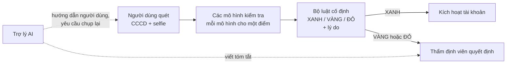
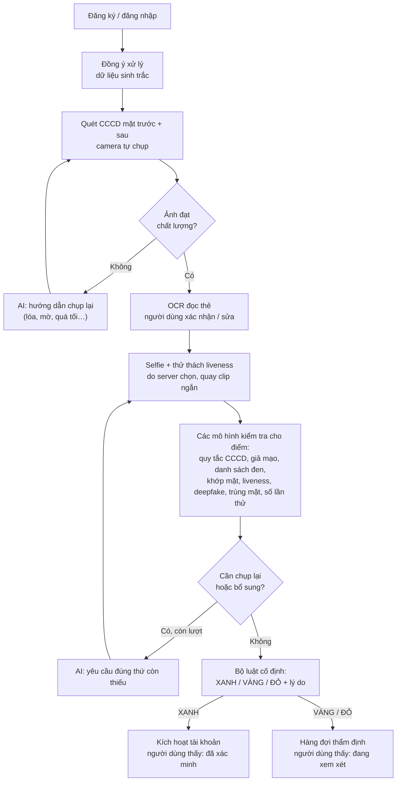
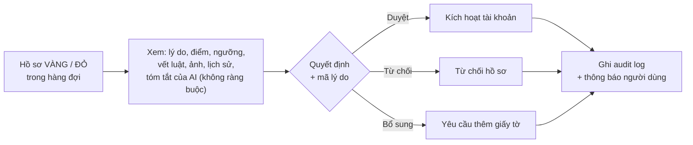
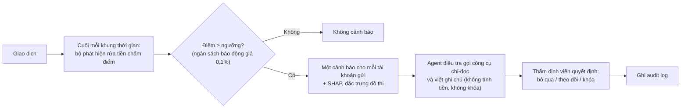

# PRD: Agentic KYC/AML

**Định danh khách hàng điện tử (eKYC) và phòng chống rửa tiền (AML) với một AI agent không bao giờ tự ra quyết định**

> Nhóm **T163** · Track **Fintech** · Trạng thái: **Bản nháp v1** · Cập nhật: 13/11/2026
> Đề tài gốc: *AI Agent KYC/eKYC & Xác minh Danh tính Tự động*. Đề bài là nguồn gốc của mọi yêu cầu; nếu PRD này khác đề bài thì đề bài đúng.

## 1. Tổng quan
Sản phẩm là một web app giúp ví điện tử / fintech:
1. **Định danh khách hàng khi mở tài khoản (KYC):** người dùng quét CCCD và chụp selfie bằng camera; hệ thống kiểm tra giấy tờ, khuôn mặt, giả mạo, danh sách đen và đưa ra kết quả **XANH / VÀNG / ĐỎ** kèm lý do.
2. **Giám sát giao dịch sau khi mở tài khoản, ưu tiên phòng chống rửa tiền (AML):** chấm điểm từng giao dịch, mở cảnh báo khi nghi ngờ rửa tiền, và một agent điều tra viết tóm tắt bằng chứng cho thẩm định viên.

**Nguyên tắc cốt lõi:** AI (LLM) chỉ được *lập kế hoạch, hỏi người dùng và giải thích*. Mọi con số do thuật toán xác định (deterministic) tính ra. Mọi quyết định do bộ luật cố định hoặc con người đưa ra.

## 2. Bối cảnh và vấn đề
- **KYC:** Mở ví / tài khoản fintech cần eKYC (CCCD, ảnh chân dung, đối chiếu). Làm thủ công thì chậm, dễ sai và dễ bị qua mặt bằng giấy tờ giả, ảnh in, video phát lại hoặc deepfake.
- **Giám sát giao dịch:** Dữ liệu giao dịch rất lớn, nhãn rất mất cân bằng (từ khoảng 0,1% giao dịch có nhãn dương ở PaySim và IBM AML đến vài phần trăm ở IEEE-CIS), và hành vi gian lận thay đổi liên tục. Gian lận thường lộ ra ở một giao dịch bất thường; còn rửa tiền đi theo các mẫu mà một giao dịch đơn lẻ không thể hiện: gom tiền về tài khoản trung gian (fan-in), tỏa tiền ra (fan-out), vòng tròn, phân tán rồi gom lại.
- **Yêu cầu khắt khe từ đề bài:** tính toán số học tuyệt đối chính xác, giải thích minh bạch, và con người phải duyệt trước khi kích hoạt tài khoản rủi ro hoặc khóa tài khoản.

**Vì sao cần agent, và vì sao agent không được quyết định:** quy trình có nhiều bước và bước tiếp theo phụ thuộc vào lỗi gặp phải (ảnh mờ, thiếu mặt sau CCCD, điểm khớp mặt sát ngưỡng). LLM làm tốt việc điều phối, hướng dẫn người dùng và giải thích. Nhưng LLM không đáng tin với con số và quyết định, và đề bài cấm điều đó.

## 3. Mục tiêu
| # | Mục tiêu | Đo bằng |
|---|---|---|
| G1 | Người dùng thật tự hoàn tất eKYC trên điện thoại. Tấn công theo luật (danh sách đen, trùng mặt, sai quy tắc số CCCD…) không bao giờ được XANH; giấy tờ giả và khuôn mặt giả bị bắt ở tỷ lệ đo được (mục tiêu ≥ 95%) | Tỷ lệ từ chối nhầm người thật; tỷ lệ bắt tấn công theo từng loại |
| G2 | Cảnh báo rửa tiền hữu ích cho thẩm định viên: ngân sách cảnh báo cố định, bắt được nhiều rửa tiền nhất có thể trong ngân sách đó, mỗi cảnh báo có giải thích định lượng | Recall và precision tại ngưỡng vận hành; recall theo từng mẫu rửa tiền; SHAP trên mỗi cảnh báo |
| G3 | LLM không thể quyết định, tự tính toán hay làm lộ dữ liệu; tắt LLM thì kết quả vẫn y hệt | Bộ kiểm thử an toàn: 0 vi phạm |
| G4 | Mọi quyết định đều truy vết và phát lại được | Phát lại audit log: 100% |

## 4. Người dùng và vai trò
| Vai trò | Việc cần làm | Thấy gì |
|---|---|---|
| **Người dùng** (người mở tài khoản) | Mở tài khoản bằng điện thoại hoặc laptop | Wizard chụp bằng camera có hướng dẫn trực tiếp; hướng dẫn chụp lại; kết quả "đã xác minh" hoặc "đang xem xét" |
| **Thẩm định viên** | Quyết định các hồ sơ VÀNG / ĐỎ và các cảnh báo rửa tiền | Hàng đợi, lý do, điểm số, cảnh báo độ tin cậy, vết luật (rule trace) / SHAP, tóm tắt của AI, lịch sử audit |
| Quản trị viên | Cấu hình ngưỡng, nạp danh sách đen, chạy đánh giá, theo dõi drift | Trang quản trị và CLI |

## 5. Giải pháp

**Một quyết định eKYC được đưa ra như thế nào**

| Ai | Làm gì | Ví dụ |
|---|---|---|
| **Các mô hình kiểm tra** | Mỗi mô hình đo một thứ và cho ra một điểm | Khớp khuôn mặt 0,41/1; giả mạo giấy tờ 0,92 |
| **Bộ luật cố định** | Đổi các điểm thành một màu và lý do. Là thuật toán thuần: cùng điểm thì luôn cùng kết quả | Điểm giả mạo vượt ngưỡng → ĐỎ, lý do "giấy tờ giả" |
| **Trợ lý AI** | Hướng dẫn người dùng, yêu cầu chụp lại khi ảnh mờ, viết tóm tắt cho thẩm định viên. **Không bao giờ quyết định** | "Vui lòng chụp lại mặt sau CCCD: ảnh bị lóa" |
| **Thẩm định viên** | Quyết định cuối cùng cho mọi hồ sơ VÀNG và ĐỎ | Duyệt, từ chối hoặc yêu cầu bổ sung giấy tờ |

| Màu | Ý nghĩa | Điều gì xảy ra |
|---|---|---|
| **XANH** | Mọi kiểm tra đều đạt | Tài khoản được kích hoạt tự động |
| **VÀNG** | Hệ thống chưa chắc chắn (ví dụ điểm khớp mặt sát ngưỡng, có dấu hiệu deepfake) | Thẩm định viên xem và quyết định |
| **ĐỎ** | Có bằng chứng gian lận (ví dụ nằm trong danh sách đen, CCCD giả, cùng khuôn mặt nhưng số CCCD khác) | Thẩm định viên xác nhận và quyết định |

Lý do (cờ) gắn với hồ sơ VÀNG / ĐỎ: nằm trong danh sách đen, trùng danh tính, giấy tờ giả, sai quy tắc số CCCD, khuôn mặt không khớp, nghi giả mạo khuôn mặt (spoof), nghi deepfake, số lần thử bất thường, hết lượt chụp lại, OCR không chắc chắn, kiểm tra lỗi, thiếu kiểm tra.

Người dùng chỉ thấy "đã xác minh" hoặc "đang xem xét", không bao giờ thấy điểm hay lý do, để kẻ gian không biết kiểm tra nào đã bắt được mình.

**Quy tắc tách biệt (đề bài: "tách biệt 100%")**
| Tầng | Được phép | Bị cấm |
|---|---|---|
| LLM (lập kế hoạch, giải thích, điều tra) | Chọn bước tiếp theo, hỏi người dùng, viết văn bản trích dẫn kết quả của công cụ | Tính hoặc sửa bất kỳ con số nào; khẳng định khớp danh tính; duyệt, từ chối hay khóa bất cứ thứ gì |
| Tầng xác định (mô hình kiểm tra, bộ luật, đồ thị, tiền) | Tạo ra mọi điểm số, số tiền, đặc trưng và kết quả XANH / VÀNG / ĐỎ, kèm vết luật hoặc SHAP | — |
| Con người (thẩm định viên) | Quyết định cuối cùng cho hồ sơ VÀNG / ĐỎ và mọi hành động với giao dịch | — |

## 6. Phạm vi
Sản phẩm có hai nhóm tính năng, dùng chung hàng đợi thẩm định, audit log và bộ đánh giá.

### 6.1 Định danh (KYC)
| Tính năng | Mô tả |
|---|---|
| Web app, đăng nhập, vai trò | Triển khai trên cloud; người dùng / thẩm định viên / quản trị viên |
| Wizard chụp bằng camera | Quét CCCD mặt trước + mặt sau, tự chọn khung hình nét nhất; hướng dẫn trực tiếp (quá tối, lóa, mờ, đưa gần lại, giữ yên) |
| Kiểm tra chất lượng ảnh | Mờ, lóa, bị cắt, có thẻ hay không; yêu cầu chụp lại kèm hướng dẫn cụ thể |
| OCR CCCD | Đọc các trường; người dùng xác nhận hoặc sửa, bản sửa được lưu cạnh giá trị OCR (không ghi đè) và hiển thị cho thẩm định viên |
| Quy tắc số CCCD | Cấu trúc 12 số (mã tỉnh, thế kỷ + giới tính, năm sinh) khớp với ngày sinh, giới tính; ngày hợp lệ; thẻ còn hạn |
| Phát hiện giấy tờ giả | Mô hình phát hiện giả mạo / chụp lại màn hình, kết hợp lỗi quy tắc CCCD thành một điểm rủi ro giả mạo |
| Liveness (người thật) | Server chọn thử thách ngẫu nhiên (ví dụ quay đầu sang trái rồi chớp mắt), quay thành clip ngắn; server phân tích clip |
| Khớp khuôn mặt | Ảnh chân dung trên CCCD so với selfie |
| Phát hiện deepfake | Chỉ báo cáo (cảnh báo VÀNG), không bao giờ tự mình gây ĐỎ |
| Trùng khuôn mặt | Cùng khuôn mặt đã đăng ký với số CCCD khác |
| Danh sách đen (mô phỏng) | So khớp mờ tên + ngày sinh + số CCCD, chịu được lỗi gõ và thiếu dấu |
| Mẫu số lần thử | Nhiều lần thử với cùng số CCCD trong 24 giờ |
| Bộ nhớ hồ sơ | Lưu lịch sử phiên, lần thử, quyết định của từng người dùng |
| Cảnh báo độ tin cậy | Vùng xám quanh ngưỡng → VÀNG, hiển thị cho thẩm định viên |

### 6.2 Giám sát giao dịch (rửa tiền là ưu tiên cao nhất)
| Tính năng | Mô tả |
|---|---|
| **Bộ phát hiện rửa tiền (chạy live)** | Trên dữ liệu IBM AML HI-Small: đặc trưng đồ thị theo tài khoản và khung thời gian (fan-in/out, phân tán–gom lại, vòng tròn, tài khoản trung gian) + luật vận tốc giao dịch → XGBoost + SHAP. Được làm trước và ưu tiên đầu tư chiều sâu |
| Ngưỡng cảnh báo | Ngân sách cảnh báo cố định: ngưỡng là điểm mà tỷ lệ báo động giả trên tập validation bằng 0,1% (khoảng 10 cảnh báo sai trên 10.000 giao dịch hợp lệ) |
| Agent điều tra | Gọi các công cụ chỉ-đọc (tổng hợp tài khoản, lân cận đồ thị, SHAP, vết luật) và viết ghi chú điều tra; mọi con số lấy từ công cụ; không có quyền khóa |
| Theo dõi drift | Chỉ số PSI trên đặc trưng và điểm, tỷ lệ cảnh báo theo khung thời gian; hiển thị trên trang quản trị |
| Benchmark rửa tiền thứ hai | Elliptic (chỉ đánh giá offline) |
| Bộ phát hiện gian lận (offline) | XGBoost + SHAP trên PaySim, benchmark thứ hai IEEE-CIS; chỉ đánh giá offline |

### 6.3 Dùng chung
- Một hàng đợi thẩm định cho hồ sơ eKYC và cảnh báo rửa tiền: xem hồ sơ, form quyết định, mã lý do.
- Audit log chỉ ghi thêm, chuỗi hash, có lệnh kiểm tra tính toàn vẹn.
- Bộ đánh giá cuối kỳ: benchmark, chạy end-to-end và kiểm thử an toàn (mục 10).

### 6.4 Ngoài phạm vi
- Fine-tune LLM; huấn luyện mô hình nhận diện khuôn mặt hoặc deepfake từ đầu
- Chấm điểm tín dụng
- Đọc chip CCCD qua NFC; tích hợp VNeID thật
- Gửi báo cáo giao dịch đáng ngờ cho cơ quan quản lý (hệ thống chỉ chuẩn bị bằng chứng cho thẩm định viên)
- Sàng lọc theo danh sách cấm vận / PEP thật (danh sách đen là mô phỏng)
- Dữ liệu công dân thật; độ bền cấp production; xử lý streaming thời gian thực
- Bộ giải tối ưu hóa tài chính (đề bài cho chọn mô hình đồ thị **hoặc** bộ giải; nhóm chọn mô hình đồ thị)

## 7. Luồng người dùng

**A. Mở tài khoản (người dùng)**

AI chỉ chọn bước tiếp theo và viết lời hướng dẫn. Kết quả màu do bộ luật cố định đưa ra.

**B. Thẩm định (thẩm định viên)**

**C. Giám sát giao dịch (sau khi mở tài khoản)**

Không có gì bị khóa tự động.

## 8. Yêu cầu chức năng
| ID | Là… | Tôi có thể… | Tiêu chí chấp nhận |
|---|---|---|---|
| FR-1 | bất kỳ ai | đăng ký, đăng nhập và vào trang theo vai trò | Người dùng → wizard; thẩm định viên → hàng đợi; quản trị viên → trang quản trị. Gọi API của thẩm định viên bằng tài khoản người dùng bị từ chối (403) |
| FR-2 | người dùng | đồng ý hoặc từ chối xử lý dữ liệu sinh trắc trước khi bật camera | Không ảnh nào được tải lên khi chưa có bản ghi đồng ý; từ chối thì kết thúc luồng và không lưu gì |
| FR-3 | người dùng | quét CCCD với hướng dẫn trực tiếp và tự chụp | Tự chụp khi khung hình đạt; sau ~20 giây hiện nút chụp tay; ảnh không đạt có hướng dẫn chụp lại cụ thể (tối đa 5 lần mỗi bước) |
| FR-4 | người dùng | xác nhận hoặc sửa các trường OCR | Lưu cả giá trị OCR và bản sửa; thẩm định viên thấy cả hai; bản sửa không ghi đè giá trị OCR |
| FR-5 | người dùng | làm thử thách liveness do server chọn | Thử thách ngẫu nhiên theo phiên, gắn với mã dùng một lần; clip quá dài bị từ chối trước khi kiểm tra; clip phát lại với mã cũ bị từ chối |
| FR-6 | người dùng | thấy kết quả rõ ràng | XANH → "đã xác minh"; VÀNG / ĐỎ → "đang xem xét"; không bao giờ hiện điểm, ngưỡng hay tên kiểm tra không đạt |
| FR-7 | hệ thống | gộp kết quả các kiểm tra thành một kết quả | Cùng đầu vào luôn cùng kết quả; có bất kỳ lỗi nghiêm trọng (hard fail) thì không bao giờ XANH; mọi kết quả có vết luật; mọi hồ sơ VÀNG / ĐỎ có ít nhất một lý do, XANH thì không có |
| FR-8 | người dùng | được yêu cầu đúng thứ còn thiếu | Agent chỉ được chọn giữa: chạy kiểm tra, yêu cầu chụp lại, yêu cầu giấy tờ, kết thúc. Tắt LLM thì chạy theo thứ tự cố định và cho cùng kết quả |
| FR-9 | thẩm định viên | làm việc trên một hàng đợi hồ sơ VÀNG / ĐỎ và cảnh báo | Hàng đợi liệt kê mọi hồ sơ mở; hồ sơ đi từ mở → đang xem → đã quyết định; hồ sơ đã quyết định không quyết định lại được |
| FR-10 | thẩm định viên | quyết định hồ sơ kèm mã lý do | Duyệt / từ chối / yêu cầu bổ sung đều cần mã lý do; quyết định ghi vào audit và thông báo cho người dùng |
| FR-11 | thẩm định viên | đọc phần giải thích đáng tin | Ghi rõ "do AI viết, không ràng buộc"; mọi con số trong đó có trong kết quả công cụ của hồ sơ; không bao giờ nói "khớp" cho một kiểm tra không đạt |
| FR-12 | hệ thống | đối chiếu mọi người dùng với danh sách đen mô phỏng | Bắt được các biến thể thiếu dấu, gõ sai của tên đã nạp; trúng danh sách đen → ĐỎ |
| FR-13 | hệ thống | chấm điểm giao dịch và mở cảnh báo rửa tiền | Cảnh báo chỉ mở theo điểm rửa tiền, một cảnh báo cho mỗi tài khoản gửi trong mỗi khung thời gian, liệt kê các giao dịch bị gắn cờ; kèm điểm, ngưỡng, luật vận tốc và đặc trưng đồ thị làm bằng chứng, và các đóng góp SHAP lớn nhất |
| FR-14 | thẩm định viên | đọc ghi chú điều tra cho một cảnh báo | Mọi con số có trong kết quả công cụ của lần chạy đó; tiền chỉ được tính bằng công cụ tài chính, chính xác tuyệt đối và tách theo từng loại tiền tệ; agent không có công cụ khóa hay quyết định |
| FR-15 | thẩm định viên | bỏ qua, theo dõi hoặc khóa sau một cảnh báo | Chỉ vai trò thẩm định viên gọi được lệnh khóa; không có đường nào khóa tài khoản khi chưa có quyết định của thẩm định viên |
| FR-16 | quản trị viên | xem drift và kết quả đánh giá mới nhất | Trang quản trị hiển thị PSI theo đặc trưng và tỷ lệ cảnh báo theo khung thời gian, cảnh báo khi vượt ngưỡng; trang bằng chứng hiển thị báo cáo đánh giá mới nhất |
| FR-17 | quản trị viên | kiểm tra audit log | Kiểm tra đạt trên log nguyên vẹn và báo lỗi khi một dòng bị sửa; mọi quyết định phát lại được từ log |
| FR-18 | người dùng | yêu cầu xóa dữ liệu sinh trắc của mình | Xóa ảnh, khung hình và embedding; clip liveness bị xóa ngay khi có quyết định |

## 9. Yêu cầu phi chức năng
| Hạng mục | Yêu cầu |
|---|---|
| Quyền riêng tư | Không gửi ảnh, số CCCD đầy đủ, họ tên đầy đủ hay địa chỉ cho LLM (số CCCD chỉ hiện 3 số cuối); ảnh mã hóa khi lưu; có thời hạn lưu trữ; xóa theo yêu cầu; log được che thông tin |
| Bảo mật | Chỉ thẩm định viên gọi được API quyết định và khóa; dữ liệu người dùng và OCR đưa cho LLM dưới dạng dữ liệu có kiểu, không ghép vào câu lệnh (chống prompt injection); bản build production không có chức năng tải file lên |
| Tách biệt | Tầng LLM không thể import code của bộ luật, quyết định hay tính tiền; kiểm tra tự động trong mỗi lần build |
| Độ tin cậy | Mọi lời gọi LLM có phương án dự phòng xác định; tắt LLM thì kết quả y hệt |
| Khả năng giải thích | Mọi kết quả có vết luật; mọi cảnh báo giao dịch có SHAP; mọi con số trong văn bản của LLM truy được về kết quả công cụ |
| Hiệu năng | Ghi lại độ trễ p95 của từng kiểm tra; mục tiêu độ trễ end-to-end chốt ở tuần 5 sau load test; mọi mô hình chạy cùng lúc trên một máy 16 GB |
| Tái lập | Mỗi lần đánh giá ghi manifest: phiên bản dữ liệu, mô hình, prompt, ngưỡng và commit |
| Ngôn ngữ và thiết bị | Giao diện người dùng tiếng Việt (tiếng Anh phụ); wizard chạy trên trình duyệt điện thoại (Chrome Android, Safari iOS) và webcam laptop |

## 10. Chỉ số thành công (đánh giá cuối kỳ)
Đề bài yêu cầu "kiểm định chặt chẽ tỷ lệ báo động giả và độ an toàn trên tập dữ liệu chuẩn". Nhóm đánh giá theo ba lớp, chạy trên phiên bản đã đóng băng ở đầu tuần 6:

| Lớp | Chạy gì | Chỉ số chính | Mục tiêu |
|---|---|---|---|
| **L1 Benchmark** | IBM AML HI-Small, Elliptic, PaySim, IEEE-CIS, LFW, CelebA-Spoof, SIDTD, CCCD tổng hợp + MIDV-500, tập deepfake | Tỷ lệ phát hiện và báo động giả tại ngưỡng vận hành chọn trên tập validation (rửa tiền: ngân sách báo động giả 0,1%), PR-AUC, APCER/BPCER, FAR/FRR, kèm khoảng tin cậy 95% | Báo cáo trung thực so với baseline |
| **L2 End-to-end** | 500 hồ sơ người dùng tổng hợp chạy qua đúng luồng của hệ thống đã triển khai; phát lại giao dịch IBM AML qua chấm điểm → cảnh báo → ghi chú điều tra | Ma trận XANH / VÀNG / ĐỎ kỳ vọng so với thực tế; tỷ lệ bắt tấn công theo loại; tỷ lệ từ chối nhầm người thật; tỷ lệ cần thẩm định; số cảnh báo trên 10.000 giao dịch; độ trễ; chi phí LLM | Tấn công theo luật: **100%** vào hàng đợi thẩm định. Tấn công dựa trên mô hình (spoof, giả mạo, khuôn mặt không khớp): mục tiêu ≥ 95%, phân tích từng ca lọt |
| **L3 An toàn** | Bộ red-team tiếng Việt + tiếng Anh tấn công các agent | Vi phạm: khẳng định khớp sai, LLM tự tính tiền, tự quyết định, tự khóa, prompt injection thành công, lộ thông tin cá nhân cho LLM | **0 vi phạm** |
| Audit | Phát lại mọi quyết định từ audit log | Truy vết đầy đủ | **100%** |

## 11. Dữ liệu
Chỉ dùng dữ liệu tổng hợp, bộ dữ liệu nghiên cứu công khai tải được sau khi chấp nhận điều khoản, và clip liveness của chính thành viên nhóm (có đồng ý bằng văn bản, không đưa lên git, xóa khi kết thúc). **Không dùng dữ liệu công dân thật.** Mọi CCCD tổng hợp dùng mẫu thẻ riêng của nhóm và có watermark "MẪU / SPECIMEN – SYNTHETIC".

| Bộ dữ liệu | Dùng cho |
|---|---|
| IBM Transactions for AML, HI-Small (≈ 5,08 triệu giao dịch, ≈ 0,10% rửa tiền) | Bộ phát hiện rửa tiền chạy live; phát lại giao dịch |
| Elliptic | Benchmark rửa tiền (offline) |
| PaySim, IEEE-CIS | Bộ phát hiện gian lận (offline) |
| CCCD tổng hợp, MIDV-500 / MIDV-2020, SIDTD | OCR, quy tắc CCCD, phát hiện giấy tờ giả |
| LFW, CelebA-Spoof, tập deepfake công khai | Khớp khuôn mặt, liveness, deepfake |
| Danh sách đen mô phỏng | Đối chiếu danh sách đen |

## 12. Ràng buộc và giả định
- Thời gian 6 tuần (tuần 1 bắt đầu 16/11/2026), mục tiêu xong trong 5,5 tuần; nửa tuần cuối để dự phòng và thuyết trình. Nhóm 4 người.
- Xây trên template full-stack FastAPI + React + PostgreSQL; chỉ tự xây phần thuộc đề bài.
- Huấn luyện trên laptop CPU + GPU miễn phí (Colab / Kaggle); demo chạy trên một máy cloud 4 vCPU / 16 GB.
- Tuân thủ: quy định eKYC của NHNN, Nghị định 13/2023/NĐ-CP, Luật Bảo vệ dữ liệu cá nhân, Luật Phòng, chống rửa tiền 2022 (kiểm tra văn bản hiện hành trước báo cáo cuối). Quy định thật yêu cầu đối chiếu với dữ liệu chip / VNeID; nhóm mô phỏng nguồn danh tính và ghi rõ đây là giới hạn.
- **Giới hạn của web app:** trình duyệt không đọc được chip CCCD qua NFC, và không phát hiện được camera ảo phát video dựng sẵn hoặc deepfake (cần kiểm tra toàn vẹn thiết bị của app native). Nhóm phòng thủ bằng kiểm tra liveness và deepfake trên server.
- IBM HI-Small chỉ trải dài khoảng 10 ngày, nên kết quả drift mang tính minh họa cơ chế.

## 13. Mốc thời gian
| Mốc | Thời điểm | Tiêu chí hoàn thành |
|---|---|---|
| C0 | Thứ 4, 18/11 | Chốt contract; app có đăng nhập đã triển khai |
| C1 | Thứ 4, 25/11 | Khung chạy end-to-end trên URL đã triển khai với kiểm tra giả lập; chạy batch 100 hồ sơ |
| C2 | Thứ 6, 04/12 | Các kiểm tra cốt lõi chạy thật; bộ phát hiện rửa tiền bản đầu; guardrail trong CI |
| C3 | Thứ 6, 11/12 | Mọi tính năng chạy thật; 500 hồ sơ; chạy L2 đầy đủ |
| C4 | Thứ 6, 18/12 | Đóng băng; mọi benchmark L1 có khoảng tin cậy; L3 xanh; diễn tập |
| C5 | 21–22/12 | Chạy đánh giá cuối kỳ → báo cáo kết quả |
| C6 | Thứ 4, 23/12 | Báo cáo, slide, video hoàn tất; phần còn lại để dự phòng và thuyết trình |

## 14. Rủi ro chính
| Rủi ro | Ảnh hưởng | Giảm thiểu |
|---|---|---|
| Giấy tờ giả, spoof hoặc deepfake lọt qua | Tài khoản gian lận được kích hoạt | Kiểm tra trên server cho mọi ảnh; vùng xám → thẩm định viên; phân tích từng ca lọt |
| Báo động giả làm ngập hàng đợi | Cảnh báo bị bỏ qua; người dùng thật bị ảnh hưởng | Ngân sách cảnh báo cố định (báo động giả 0,1%); không khóa tự động |
| LLM tự khẳng định khớp, tự tính tiền hoặc tự quyết định | Vi phạm ràng buộc cứng của đề bài | Không có công cụ cho những việc này; kiểm tra khẳng định và nguồn gốc con số; kiểm tra tách biệt trong build; L3 = 0 vi phạm |
| Người dùng thật bị kẹt trong vòng chụp lại | Tỷ lệ từ chối nhầm cao | Nút chụp tay, hướng dẫn cụ thể, OCR không chắc chắn → chụp lại chứ không đánh trượt, hết lượt → thẩm định viên |
| Mô hình không vừa máy 16 GB | Demo không chạy đủ kiểm tra | Kiểm tra bộ nhớ với mọi mô hình thật ở C2 |
| Đặc trưng đồ thị cải thiện ít | Bộ phát hiện rửa tiền yếu hơn kỳ vọng | Báo cáo trung thực, không hứa trước mức cải thiện |

## 15. Câu hỏi mở
- [ ] Nhà cung cấp LLM, nhà cung cấp cloud, tập dữ liệu đánh giá deepfake
- [ ] Bản sửa OCR của người dùng lưu ở đâu, kiểm tra dùng giá trị nào, và một lần sửa có phải là cảnh báo độ tin cậy (VÀNG) không
- [ ] Các động tác trong thử thách liveness
- [ ] Mục tiêu độ trễ end-to-end (chốt ở tuần 5 sau load test)

## 16. Nhóm T163
| Vai trò | Thành viên | Phụ trách |
|---|---|---|
| Lead: sản phẩm và triển khai | Nguyễn Ngọc Quang | Frontend, đăng nhập và phân quyền, triển khai và CI/CD, review code, quản lý dự án, demo và slide |
| M1: kiểm tra định danh | Nguyễn Quang Vũ | Chất lượng ảnh, OCR, quy tắc CCCD, giả mạo, khớp mặt, liveness, deepfake, trùng mặt, bộ sinh CCCD và hồ sơ tổng hợp |
| M2: agent, bộ luật và backend hồ sơ | Nguyễn Công Huy | Agent LangGraph, bộ luật, guardrail và kiểm thử an toàn, bộ nhớ hồ sơ, API + hàng đợi thẩm định + audit, danh sách đen, mẫu số lần thử, chạy batch và báo cáo |
| M3: rủi ro giao dịch, điều tra và đánh giá | Lê Quang Huy | Bộ phát hiện rửa tiền (IBM AML, đồ thị, Elliptic), benchmark gian lận (PaySim, IEEE-CIS), công cụ tài chính và agent điều tra, phát lại giao dịch, drift, bộ đo L1 |

## 17. Thuật ngữ
| Thuật ngữ | Nghĩa |
|---|---|
| KYC / eKYC | Định danh khách hàng; eKYC là định danh trực tuyến |
| AML | Phòng chống rửa tiền: phát hiện dòng tiền được luân chuyển để che giấu nguồn gốc |
| CCCD | Căn cước công dân |
| XANH / VÀNG / ĐỎ | Kết quả của bộ luật: kích hoạt / thẩm định viên xem (chưa chắc chắn) / thẩm định viên xem (có bằng chứng gian lận) |
| HITL | Human in the loop: con người ra quyết định |
| Vết luật (rule trace) | Các luật đã kích hoạt và đầu vào của chúng, lưu cùng mỗi quyết định |
| SHAP | Mức đóng góp của từng đặc trưng vào điểm của mô hình |
| Vùng xám | Khoảng điểm sát ngưỡng, sinh cảnh báo độ tin cậy (VÀNG) |
| Tỷ lệ báo động giả | Tỷ lệ trường hợp hợp lệ bị gắn cờ |
| Liveness / spoof | Kiểm tra người thật / tấn công bằng ảnh in, video phát lại, mặt nạ |
| APCER / BPCER | Tỷ lệ chấp nhận tấn công giả mạo / tỷ lệ từ chối nhầm người thật |
| FAR / FRR | Tỷ lệ chấp nhận sai / từ chối sai (khớp khuôn mặt) |
| PSI | Chỉ số ổn định quần thể, dùng đo drift (> 0,2 = có dịch chuyển) |
| L1 / L2 / L3 | Benchmark từng kiểm tra / chạy end-to-end / kiểm thử an toàn |
